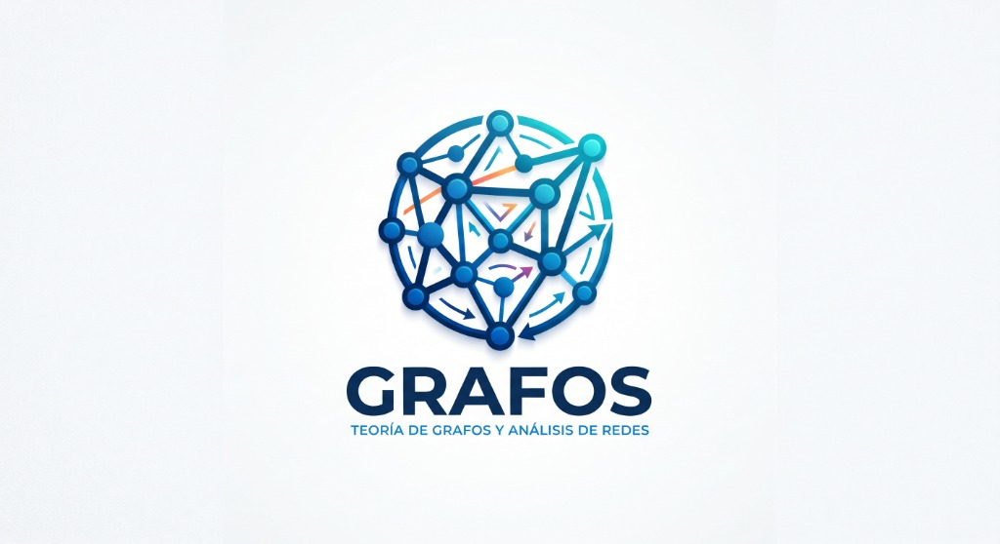

# 🌐 GRAFOS Studio Enterprise (Recluta 22: ag-graph-visualizer-22)

[](https://grafos-network.web.app)
[](https://grafos-network.web.app)
[](LICENSE)

Estación de trabajo enterprise para **modelado matemático de grafos, análisis topológico de redes complejas, físicas interactivas en tiempo real y forja asistida por Inteligencia Artificial (BYOK Zero-Knowledge)**.



---

## 🚀 Despliegue en Vivo
Acceso inmediato desde cualquier dispositivo (PC, móvil, tablet):
👉 **[https://grafos-network.web.app](https://grafos-network.web.app)**

---

## ✨ Características Principales

### 📐 1. Visualización Topológica y Algoritmos de Layout
- **Físicas en Tiempo Real (D3.js v7):** Simulación elástica *Force-Directed*, repulsión de muchos cuerpos, distancia de aristas, gravedad central y detección de colisiones.
- **Distribuciones Alternativas:**
  - **Concéntrico:** Ordenamiento por anillos radiales según métricas de centralidad (*PageRank* o *Grado*).
  - **Circular:** Distribución perimetral uniforme.
  - **Grilla Matricial:** Ordenamiento cartesiano para análisis estructural.
- **Foco Ego-Network:** Al posar el cursor sobre cualquier nodo, se atenúa el resto de la red e ilumina solo las relaciones directas entrantes y salientes.
- **Radar Topológico (Mini-map):** Vista panorámica en Canvas sincronizada en tiempo real.

### 🔒 2. Bóveda BYOK Zero-Knowledge (Nivel Bancario)
- **Cifrado en Memoria de Cliente (`AES-256-GCM`):** Utiliza la *Web Cryptography API* nativa.
- **Cero Fugas a Servidores:** Las peticiones a modelos de lenguaje se realizan **directamente desde tu navegador** hacia los endpoints oficiales de cada proveedor vía HTTPS seguro.
- **Proveedores Soportados:** Groq (Qwen 3.8 / GPT-OSS ultra-rápido), Google Gemini (AI Studio), NVIDIA NIM, OpenAI y OpenRouter.
- **Auto-Detección Inteligente:** Detecta el formato de la clave al escribir o pegar (`gsk_...`, `nvapi-...`, `AIzaSy...`, `sk-...`).
- **Botón de Pánico Táctico:** Destruye las credenciales de la memoria RAM con un solo clic.

### 🤖 3. Forjador de Grafos con IA (Prompt a Red)
- Convierte lenguaje natural o datos crudos (CSV, listas, arquitecturas de software) en un grafo interactivo con cálculo automático de conectividad, paletas semánticas y jerarquías.

### 📱 4. Aplicación Web Progresiva (PWA Instalable)
- Instalable como aplicación nativa en la pantalla de inicio de Android, iOS, Windows, Mac y Linux.
- Soporte offline mediante Service Worker (`sw.js`).

---

## 🧪 Caso de Estudio: Red Topológica de las Tablas de Multiplicar (0 al 9)
Modelado de las 100 operaciones multiplicativas posibles ($0 \times 0$ a $9 \times 9$):
- **37 Nodos Únicos:** Exactamente los 37 productos distintos de la tabla pitagórica.
- **127 Conexiones Ponderadas:** Flujo de multiplicación, conmutatividad ($a \times b \leftrightarrow b \times a$) y auto-bucles de resonancia cuadrada.
- **El Gran Atractor Cero `[0]`:** PageRank máximo absoluto (0.2322), absorbiendo casi el 25% de la probabilidad de caminos de la red.
- **Alta Convergencia:** Nodos `12`, `18`, `24` y `36`.

---

## 🛠️ Instalación y Ejecución Local

```bash
# Clonar el repositorio
git clone https://github.com/informaticasurr-maker/grafos-studio.git
cd grafos-studio

# Iniciar servidor local
./iniciar_studio.sh
# O con python directamente:
python3 -m http.server 8090
```

---

## 📄 Licencia
Distribuido bajo la licencia MIT.
Desarrollado en el Centro de Comando **IDE ANTIGRAVITY** por el Recluta **`22-graph-network-visualizer`**.
